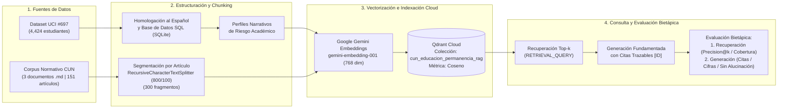

# Análisis de Permanencia Estudiantil y Sistema RAG en la Nube (CUN)

**Institución:** Corporación Unificada Nacional de Educación Superior (CUN) — Escuela de Ingeniería  
**Programa:** Especialización en Inteligencia Artificial  

---

## Descripción General

Este repositorio contiene el estudio analítico y la implementación de una arquitectura de **Recuperación Aumentada por Generación (RAG)** orientada a la consulta de normatividad institucional, becas de bienestar y seguimiento de permanencia estudiantil en educación superior.

El sistema integra:
1. **Datos estructurados de trayectoria académica:** Conjunto de datos [UCI Predict Students' Dropout and Academic Success (ID 697)](https://archive.ics.uci.edu/dataset/697/predict+students+dropout+and+academic+success) (*4,424 registros y 37 variables*), decodificado al español, enriquecido con indicadores de alerta temprana (`Bajo`, `Medio`, `Alto`), almacenado relacionalmente en SQL (`SQLite`) y transformado en perfiles narrativos semánticos.
2. **Corpus normativo no estructurado (CUN):** Tres documentos oficiales vigentes en formato Markdown con encabezado de metadatos YAML, segmentados estructuralmente por capítulos y artículos:
   - `data/docs/reglamento-estudiantil.md` — *Acuerdo No. 019 de 2023 (Reglamento Estudiantil CUN, 98 artículos)*.
   - `data/docs/reglamento-bienestar.md` — *Acuerdo No. 022 de 2018 (Reglamento de Bienestar Institucional CUN, 46 artículos)*.
   - `data/docs/resolucion-007-2024-becas-rendimiento-academico.md` — *Resolución Rectoral No. 007 de 2024 (Presupuesto y lineamientos de becas, 7 artículos)*.

---

## Arquitectura del Pipeline



---

## Estructura del Repositorio

```text
.
├── .env.example                                              # Plantilla de variables de entorno (sin credenciales)
├── .gitignore                                                # Exclusión de credenciales, cachés y archivos autogenerados
├── README.md                                                 # Documentación técnica del proyecto
├── RAG_Educacion.ipynb                                       # Notebook principal reproducible (EDA + SQL + RAG + Evaluación)
└── data/
    └── docs/                                                 # Corpus normativo oficial de la CUN (versionado en Git)
        ├── reglamento-bienestar.md                           # Acuerdo No. 022 de 2018 (46 artículos -> 104 fragmentos)
        ├── reglamento-estudiantil.md                         # Acuerdo No. 019 de 2023 (98 artículos -> 178 fragmentos)
        └── resolucion-007-2024-becas-rendimiento-academico.md # Resolución No. 007 de 2024 (7 artículos -> 18 fragmentos)
```

> **Nota sobre archivos autogenerados:** Al ejecutar `RAG_Educacion.ipynb`, el notebook descarga automáticamente el dataset UCI #697 y genera localmente los directorios `data/csv/` (archivos CSV homologados y cachés locales de vectores/respuestas) y `data/sql/cun_permanencia_academica.db` (base de datos relacional SQLite), los cuales están excluidos mediante `.gitignore`.

---

## Principales Resultados

### 1. Hallazgos del Análisis Exploratorio de Datos (EDA)
- **Distribución de la variable objetivo:** Graduados (**49.93%**), Deserción (**32.12%**) y Matriculados (**17.95%**).
- **Determinantes financieros:** Los estudiantes con mora en matrícula presentan una tasa de deserción del **86.6%** (frente a **24.7%** en quienes están al día). Contar con beca incrementa la tasa de graduación al **76.0%**.
- **Determinantes académicos:** El número de unidades aprobadas y el promedio en los dos primeros semestres exhiben las correlaciones positivas más altas con la graduación ($r = +0.49$ a $+0.62$).

### 2. Segmentación del Corpus Normativo CUN
Se evaluaron tres configuraciones de `RecursiveCharacterTextSplitter` respetando las fronteras de capítulo y artículo, seleccionando `chunk_size = 800` y `chunk_overlap = 100`:

| Documento Normativo | Artículos | Caracteres | Fragmentos (`800/100`) |
| :--- | :---: | :---: | :---: |
| `reglamento-estudiantil.md` (Acuerdo 019 de 2023) | 98 | 87,171 | 178 |
| `reglamento-bienestar.md` (Acuerdo 022 de 2018) | 46 | 54,647 | 104 |
| `resolucion-007-2024-becas-rendimiento-academico.md` | 7 | 9,108 | 18 |
| **Total Corpus Normativo CUN** | **151** | **150,926** | **300** |

### 3. Evaluación Bietápica del Sistema RAG (Recuperación y Generación)

| Caso de Evaluación | Similitud Top-1 | Precisión Fuente@4 | Cobertura Artículos | Precisión de Citas | Fidelidad de Cifras | Estado de Fidelidad |
| :--- | :---: | :---: | :---: | :---: | :---: | :--- |
| `C1_Becas_Bienestar` | `0.7133` | `100.0%` | `100.0%` | `100.0%` | `100.0% (11/11)` | Verificada (Sin alucinación) |
| `C2_Reglamento_Estudiantil` | `0.7203` | `100.0%` | `100.0%` | `100.0%` | `100.0% (18/18)` | Verificada (Sin alucinación) |
| `C3_Perfiles_Riesgo_UCI` | `0.7601` | `100.0%` | `100.0%` | `100.0%` | `100.0% (42/42)` | Verificada (Sin alucinación) |
| `C4_Control_No_Alucinacion` | `0.6343` | `100.0%` | `100.0%` | `100.0%` | `100.0% (Abstención)` | Verificada (Sin alucinación) |

---

## Configuración y Ejecución

1. **Clonar el repositorio y configurar variables de entorno:**
   ```bash
   cp .env.example .env
   ```
   Editar el archivo `.env` con las credenciales de **Qdrant Cloud** y **Google Gemini API**:
   ```env
   QDRANT_URL=https://<cluster-id>.<region>.aws.cloud.qdrant.io
   QDRANT_API_KEY=<tu-qdrant-api-key>
   GEMINI_API_KEY=<tu-gemini-api-key>
   ```

2. **Ejecutar el Notebook:**
   Abrir `RAG_Educacion.ipynb` en Jupyter Lab, VS Code o Google Colab y ejecutar las celdas en orden secuencial. La primera celda instala e importa automáticamente todas las dependencias necesarias (`ucimlrepo`, `pandas`, `numpy`, `matplotlib`, `seaborn`, `python-dotenv`, `langchain-text-splitters`, `qdrant-client`, `google-genai`).

---

## Referencias

- Chase, H. (2022). *LangChain: Building applications with LLMs through composability and data augmented generation*. https://github.com/langchain-ai/langchain
- Corporación Unificada Nacional de Educación Superior [CUN]. (2018). *Acuerdo No. 022 de 2018: Reglamento de Bienestar Institucional*.
- Corporación Unificada Nacional de Educación Superior [CUN]. (2023). *Acuerdo No. 019 de 2023: Reglamento Estudiantil*.
- Corporación Unificada Nacional de Educación Superior [CUN]. (2024). *Resolución Rectoral No. 007 de 2024: Presupuesto y lineamientos de becas*.
- Lewis, P., Perez, E., Piktus, A., Petroni, F., Karpukhin, V., Goyal, N., et al. (2020). Retrieval-augmented generation for knowledge-intensive NLP tasks. *Advances in Neural Information Processing Systems*, 33, 9459–9474.
- Martins, M. V., Tolledo, D., Machado, J., Baptista, L. M. T., & Realinho, V. (2021). Early prediction of student's performance in higher education: A case study. En *Trends and Applications in Information Systems and Technologies (WorldCIST 2021), Advances in Intelligent Systems and Computing* (Vol. 1365, pp. 166–175). Springer. https://doi.org/10.1007/978-3-030-72657-7_16
- Qdrant Solutions GmbH. (2024). *Qdrant Documentation: Vector Search Engine & Cloud Database*. https://qdrant.tech/documentation/
- Realinho, V., Machado, J., Baptista, L., & Martins, M. V. (2022). Predicting student dropout and academic success. *Data*, 7(11), 146. https://doi.org/10.3390/data7110146
- Realinho, V., Vieira Martins, M., Machado, J., & Baptista, L. (2021). *Predict Students' Dropout and Academic Success* [Conjunto de datos]. UCI Machine Learning Repository. https://doi.org/10.24432/C5MC89

